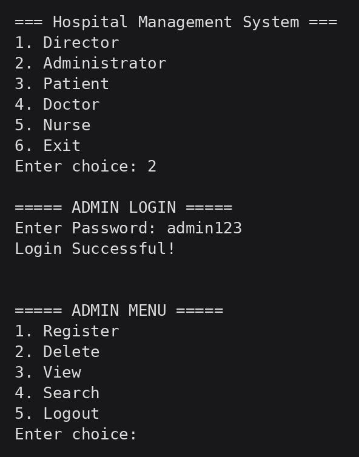
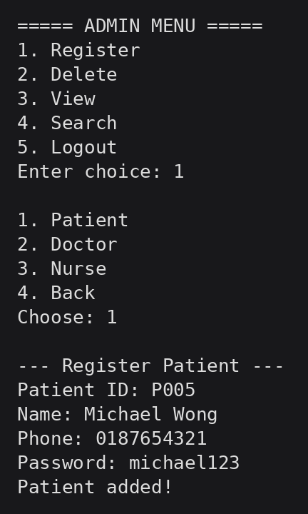
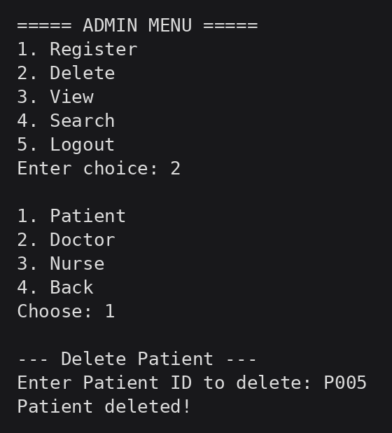
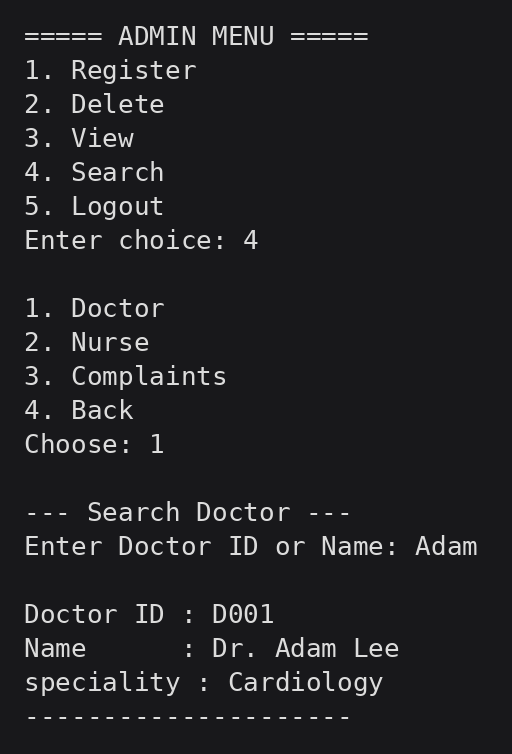
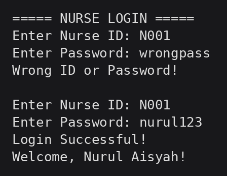
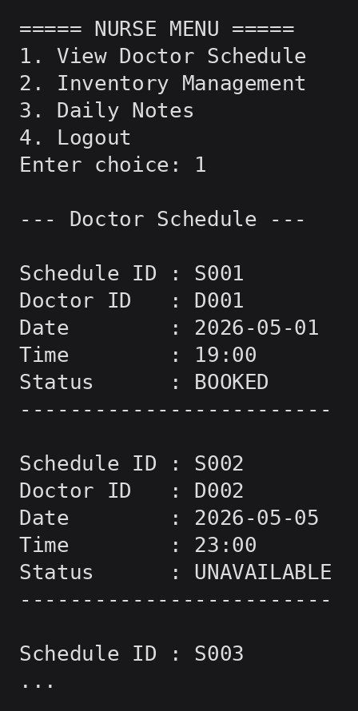
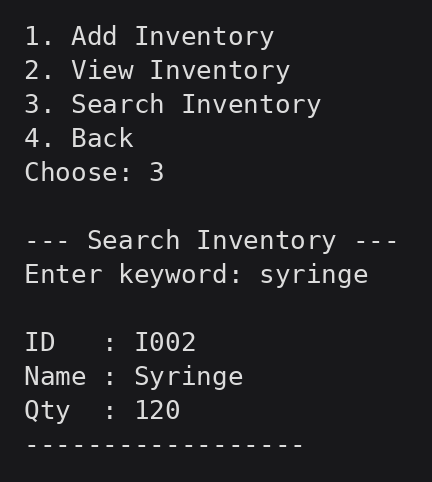

# Hospital Management System (C)

A console-based hospital management system written in C, with role-based menus for five types of users (Director, Administrator, Patient, Doctor, Nurse) and plain-text files used as a persistent database.

> Group project for **CT018-3-1-ICP Introduction to C Programming** at Asia Pacific University (APU), Malaysia, built by a team of 4 from April to June 2026.



## Contributions

Each team member owned one or more role modules and part of the written report.

### [Juan Tanoto](https://github.com/Juan-Tanoto): Administrator and Nurse modules

Two of the five modules (about 1,200 of the ~4,200 lines of code), plus the report's Introduction & Assumptions section and document formatting.

**Administrator** ([`src/administrator.c`](src/administrator.c))
- Password-protected login limited to 3 attempts
- Register patients, doctors, and nurses with **duplicate-ID detection** before writing to file
- **Generic delete function** that works for any record type: it copies every line except the target to a temporary file, then replaces the original (safe update pattern for flat files)
- View and keyword search across patients, doctors, nurses, and complaints
- Shared helpers declared in `main.h`: `isDuplicateID()` (also used for inventory items) and `ensureNewline()` to keep the file format consistent when appending
- Input-buffer handling so invalid menu input does not break the program loop

**Nurse** ([`src/nurse.c`](src/nurse.c))
- Login against `nurses.txt` with empty-input validation and a 3-attempt limit
- View all doctor schedules
- Inventory management: add items (with duplicate-ID check), view, and search
- Daily patient notes: add, view, and search
- **Case-insensitive keyword search** for inventory and notes

### [Davin Augusta Law](https://github.com/Dappinn-16): Director module

[`src/director.c`](src/director.c): staff report, yearly sales report, master schedule that maps doctor IDs to names, database backup utility, and patient complaint dashboard. Also wrote parts of the Nurse documentation (concepts and sample outputs).

### [Jevon Cliven Ramaputra Rofendy](https://github.com/jevoncliven): Patient module

[`src/patient.c`](src/patient.c): book, reschedule, and cancel appointments with automatic slot availability, payments, and complaints. Also wrote parts of the Nurse documentation (concepts, pseudocode, flowchart).

### [Aska Aidan](https://github.com/Vioclast): Doctor module

[`src/doctor.c`](src/doctor.c): manage schedules and add, view, and search diagnostic reports (by patient, date range, or diagnosis). Also wrote parts of the Nurse documentation and the report's conclusion.

All four members worked on the shared menu UI.

## Features by Role

| Role | Main functions | Author |
|---|---|---|
| Director | Staff report, yearly sales report, master schedule, database backup, complaint dashboard | [Davin Augusta Law](https://github.com/Dappinn-16) |
| Administrator | Register / delete / view / search patients, doctors, nurses; view complaints | [Juan Tanoto](https://github.com/Juan-Tanoto) |
| Patient | Book, reschedule, cancel appointments; payments; complaints | [Jevon Cliven Ramaputra Rofendy](https://github.com/jevoncliven) |
| Doctor | Manage schedules; add, view, and search diagnostic reports (by patient, date range, diagnosis) | [Aska Aidan](https://github.com/Vioclast) |
| Nurse | View doctor schedules; inventory management; daily patient notes | [Juan Tanoto](https://github.com/Juan-Tanoto) |

## Concepts Used

Modular programming (one source file per role plus a shared header), structures, unions, linked lists, arrays, pointers, string handling, file I/O with a pipe-delimited text format, and input validation (empty input, numeric input, duplicate IDs, menu bounds, file-open errors).

## Project Structure

```
.
├── src/
│   ├── main.c            # Entry point and role selection menu
│   ├── main.h            # Shared constants, structs, and function prototypes
│   ├── administrator.c   # Administrator module
│   ├── nurse.c           # Nurse module
│   ├── director.c
│   ├── patient.c
│   └── doctor.c
├── data/                 # Sample "database" (.txt files, pipe-delimited)
├── docs/screenshots/
└── Makefile
```

## How to Run

Requires a C compiler such as GCC (on Windows: MinGW-w64 or MSYS2).

```bash
# Linux / macOS / Git Bash
make run
```

Without `make`:

```bash
gcc -Wall -std=c99 -o hms src/*.c
cd data
../hms          # on Windows: ..\hms.exe
```

The program reads and writes the `.txt` files in the current directory, so run it from inside `data/`.

### Demo Logins (sample data only)

| Role | ID / Username | Password |
|---|---|---|
| Director | `director` | `director123` |
| Administrator | (none) | `admin123` |
| Doctor | `D001` | `adam123` |
| Nurse | `N001` | `nurul123` |
| Patient | `P001` | `daniel123` |

All names and records in `data/` are fictional test data.

## Screenshots

| Register patient | Delete record | Search |
|---|---|---|
|  |  |  |

| Nurse login (attempt limit) | Doctor schedule | Inventory search |
|---|---|---|
|  |  |  |

## Limitations and Possible Improvements

This was an introductory C course project, so some design choices are deliberately simple:
- Passwords are stored in plain text and the admin password is hard-coded. A real system would hash passwords (e.g. bcrypt) and store credentials separately.
- Flat text files instead of a database, so there is no concurrent access or indexing. SQLite would be a natural next step.
- Console interface only.
